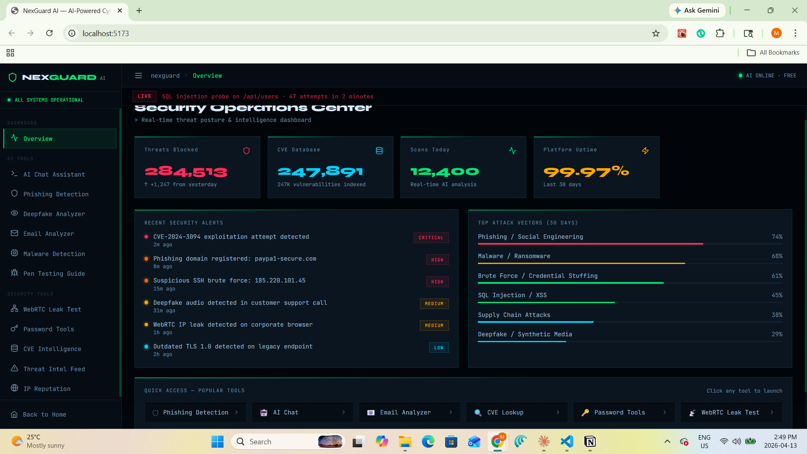

<div align="center">

```
███╗   ██╗███████╗██╗  ██╗ ██████╗ ██╗   ██╗ █████╗ ██████╗ ██████╗      █████╗ ██╗
████╗  ██║██╔════╝╚██╗██╔╝██╔════╝ ██║   ██║██╔══██╗██╔══██╗██╔══██╗    ██╔══██╗██║
██╔██╗ ██║█████╗   ╚███╔╝ ██║  ███╗██║   ██║███████║██████╔╝██║  ██║    ███████║██║
██║╚██╗██║██╔══╝   ██╔██╗ ██║   ██║██║   ██║██╔══██║██╔══██╗██║  ██║    ██╔══██║██║
██║ ╚████║███████╗██╔╝ ██╗╚██████╔╝╚██████╔╝██║  ██║██║  ██║██████╔╝    ██║  ██║██║
╚═╝  ╚═══╝╚══════╝╚═╝  ╚═╝ ╚═════╝  ╚═════╝ ╚═╝  ╚═╝╚═╝  ╚═╝╚═════╝     ╚═╝  ╚═╝╚═╝
```

**AI-Powered Cybersecurity Platform — v2.0**

[](https://nodejs.org)
[](https://reactjs.org)
[](https://mongodb.com/atlas)
[](https://anthropic.com)
[](LICENSE)
[](CONTRIBUTING.md)

**19 Security Tools · JWT Authentication · Real-Time Threat Intel · 100% Free API Tiers**

[🚀 Live Demo](#quick-start) · [📖 Setup Guide](#quick-start) · [🐛 Report Bug](../../issues) · [💡 Feature Request](../../issues)

</div>

---

## 📸 Screenshots

> Dashboard · AI Chat · Phishing Detection · Live Threat Feed



---

## ✨ What's New in v2.0

- 🔐 **Full authentication system** — JWT (7-day expiry), bcrypt password hashing, user registration & login
- 📧 **Transactional email** — Brevo-powered welcome emails and breach notifications
- 💾 **Scan history persistence** — every scan saved to MongoDB Atlas per authenticated user
- 🛡️ **7 new Phase 2 tools** — VirusTotal, DNS/WHOIS, SSL/TLS, Subdomain Enumeration, Breach Monitor, extended IP Reputation, enhanced CVE search
- 📡 **Live Global Threat Feed** — CISA KEV catalog with 30-second polling and broadcast alerts
- 🌐 **Guest mode** — all tools accessible without login; register to save history

---

## 🧰 All 19 Security Tools

### 🤖 AI-Powered Tools (8 engines — Claude 3.5 Haiku)

| Tool | Description |
|------|-------------|
| **AI Security Chat** | Ask anything — CVEs, attack techniques, incident response, OSINT. Rate-limited to 20 req/min |
| **Phishing Detector** | Analyzes 12 URL signals: domain age, lookalike brand, TLD risk, keyword patterns, redirect chains |
| **Deepfake Analyzer** | Upload images — AI checks facial geometry, lighting artifacts, edge anomalies, skin texture |
| **Email Header Analyzer** | Full forensics: SPF/DKIM/DMARC, homoglyph detection, BEC patterns, originating IP |
| **Malware Code Scanner** | Paste code or hashes — AI identifies reverse shells, persistence, C2 callbacks, MITRE ATT&CK mapping |
| **Pentest Assistant** | OWASP/PTES/NIST-aligned methodology generator for authorized testing scenarios |
| **CVE Intelligence** | Deep AI analysis of any CVE — severity context, exploitation status, remediation steps |
| **IP Reputation** | AI-enriched AbuseIPDB lookup — Tor nodes, botnet C2, VPN exit, abuse history, geolocation |

### 🔒 Security Tools (6 tools)

| Tool | Description |
|------|-------------|
| **WebRTC IP Leak Test** | Runs entirely in-browser — reveals real IP behind VPN via RTCPeerConnection ICE candidates |
| **Password Strength Checker** | zxcvbn-based estimator with crack time, dictionary & pattern analysis |
| **Password Generator** | `window.crypto`-based — up to 128 characters, zero server calls, nothing logged |
| **CVE Search (NIST NVD)** | Live NVD v2 API — CVSS score, affected versions, vendor advisories |
| **Threat Intel Feed** | CISA KEV + NVD aggregated feed with search, filtering, and card detail view |
| **Scan History Workspace** | Paginated personal scan log — per-user, authenticated, stored in MongoDB |

### 🧪 Phase 2 — Advanced Tools (5 tools)

| Tool | Description |
|------|-------------|
| **VirusTotal Scanner** | Scan URLs, file hashes against 72 AV engines simultaneously — 500 scans/day free tier |
| **DNS & WHOIS Lookup** | A, AAAA, MX, NS, TXT records + full WHOIS — compare legitimate vs phishing domains |
| **SSL/TLS Analyzer** | Certificate chain, issuer, expiry, TLS version, cipher suite, HSTS, OCSP, grade (A+ to F) |
| **Subdomain Enumeration** | DNS brute-force + Certificate Transparency logs (crt.sh) + zone walking |
| **Breach Monitor** | Email breach lookup — breach name, date, record count, data classes, recommended actions |

### 📡 Live Intel (1 feed)

| Tool | Description |
|------|-------------|
| **Live Global Threat Feed** | CISA KEV catalog, 30-second polling, severity badges, "Alert All Users" broadcast button |

---

## 🚀 Quick Start

### Prerequisites

- [Node.js](https://nodejs.org) v22 or higher
- [Git](https://git-scm.com)
- [MongoDB Atlas](https://mongodb.com/atlas) free cluster (M0)
- API keys (see Environment Variables below)

### 1. Clone the Repository

```bash
git clone https://github.com/malavmehta7101/nexguard-ai.git
cd nexguard-ai
```

### 2. Set Up the Backend

```bash
cd Backend
npm install
cp .env.example .env   # then edit .env with your keys
```

### 3. Configure Environment Variables

```env
# MongoDB
MONGODB_URI=mongodb+srv://<user>:<password>@cluster0.lwxdtub.mongodb.net/nexguard

# JWT
JWT_SECRET=your-random-secret-at-least-32-chars

# Anthropic (Claude AI)
ANTHROPIC_API_KEY=sk-ant-...

# VirusTotal — free at https://virustotal.com
VIRUSTOTAL_API_KEY=your-key

# AbuseIPDB — free at https://abuseipdb.com
ABUSEIPDB_API_KEY=your-key

# Brevo transactional email — free at https://brevo.com
BREVO_API_KEY=xkeysib-...
FROM_EMAIL=mehtamalav59@gmail.com   # must be a verified Brevo sender

# Server
PORT=3001
FRONTEND_URL=http://localhost:5173
NODE_ENV=development
```

> 💡 CISA KEV and NIST NVD are completely free — no API key needed.

### 4. Start the Backend

```bash
npm start
# ✅ Connected to MongoDB Atlas
# 🛡️  NexGuard AI Backend running on port 3001
```

### 5. Set Up and Start the Frontend

```bash
# New terminal
cd frontend
npm install
npm run dev
# ➜  Local:   http://localhost:5173
```

### 6. Open in Browser

```
http://localhost:5173
```

Register an account or use the demo credentials: `demo@test.com` / `SecurePass123`

---

## 📁 Project Structure

```
nexguard-ai/
│
├── Backend/                          # Node.js 22 + Express
│   ├── models/
│   │   ├── User.js                   # Mongoose user schema (bcrypt, JWT)
│   │   └── ScanHistory.js            # Per-user scan log
│   ├── routes/
│   │   ├── auth.js                   # Register, login, JWT middleware
│   │   ├── ai.js                     # All 8 Claude AI endpoints
│   │   ├── tools.js                  # Security tool endpoints
│   │   ├── phase2.js                 # VirusTotal, DNS, SSL, Subdomains, Breach
│   │   ├── incidents.js              # Live feed + alert broadcast
│   │   └── scanHistory.js            # Scan persistence CRUD
│   ├── middleware/
│   │   └── auth.js                   # JWT verification middleware
│   ├── server.js                     # Express, CORS, rate limiting, routes
│   └── package.json
│
└── Frontend/                         # React 18 + Vite
    ├── src/
    │   ├── pages/
    │   │   ├── Landing.jsx           # Interactive landing page
    │   │   ├── Dashboard.jsx         # Main app shell + sidebar
    │   │   ├── Login.jsx
    │   │   └── Register.jsx
    │   ├── components/
    │   │   ├── MatrixRain.jsx        # Animated matrix background
    │   │   ├── ThreatTicker.jsx      # Live threat scroll ticker
    │   │   └── LegalDisclaimer.jsx   # Legal disclaimer modal
    │   └── tools/                    # All 19 tool components
    │       ├── Overview.jsx
    │       ├── AIChat.jsx
    │       ├── PhishingDetector.jsx
    │       ├── DeepfakeAnalyzer.jsx
    │       ├── EmailAnalyzer.jsx
    │       ├── MalwareDetector.jsx
    │       ├── PenTesting.jsx
    │       ├── WebRTCChecker.jsx
    │       ├── PasswordTools.jsx
    │       ├── CVELookup.jsx
    │       ├── ThreatIntel.jsx
    │       ├── IPReputation.jsx
    │       ├── VirusTotalScanner.jsx
    │       ├── DNSLookup.jsx
    │       ├── SSLAnalyzer.jsx
    │       ├── SubdomainEnum.jsx
    │       ├── BreachMonitor.jsx
    │       ├── ScanHistory.jsx
    │       └── LiveFeed.jsx
    ├── index.html
    ├── vite.config.js
    └── package.json
```

---

## 🔌 API Endpoints

### Auth Endpoints (`/api/auth/`)

| Method | Endpoint | Description |
|--------|----------|-------------|
| POST | `/api/auth/register` | Register — bcrypt hash, JWT issue, Brevo welcome email |
| POST | `/api/auth/login` | Login — JWT (7-day expiry) |
| GET | `/api/auth/me` | Get current user (JWT required) |

### AI Endpoints (`/api/ai/`)

| Method | Endpoint | Description |
|--------|----------|-------------|
| POST | `/api/ai/chat` | AI security chat (conversation history) |
| POST | `/api/ai/phishing` | Phishing URL analysis (12 signals) |
| POST | `/api/ai/deepfake` | Deepfake image analysis (file upload) |
| POST | `/api/ai/email` | Email header forensics |
| POST | `/api/ai/malware` | Malware code/hash analysis |
| POST | `/api/ai/pentest` | Pentest methodology generation |
| POST | `/api/ai/cve` | CVE deep analysis |
| POST | `/api/ai/ip` | IP reputation analysis |

### Security Tool Endpoints (`/api/tools/`)

| Method | Endpoint | Description |
|--------|----------|-------------|
| GET | `/api/tools/threat-feed` | Curated CVE feed (NVD + CISA) |
| GET | `/api/tools/webrtc-config` | WebRTC test configuration |
| POST | `/api/tools/generate-password` | Secure password generator |
| GET | `/api/tools/cve/:id` | NIST NVD CVE lookup |
| GET | `/api/stats` | Platform statistics |
| GET | `/api/health` | Health check |

### Phase 2 Endpoints (`/api/phase2/`)

| Method | Endpoint | Description |
|--------|----------|-------------|
| POST | `/api/phase2/virustotal` | VirusTotal scan (URL or hash) |
| POST | `/api/phase2/dns` | DNS + WHOIS lookup |
| POST | `/api/phase2/ssl` | SSL/TLS certificate analysis |
| POST | `/api/phase2/subdomains` | Subdomain enumeration |
| POST | `/api/phase2/breach` | Email breach check |

### Live Feed Endpoints (`/api/incidents/`)

| Method | Endpoint | Description |
|--------|----------|-------------|
| GET | `/api/incidents/feed` | Live CISA KEV feed (polled every 30s) |
| POST | `/api/incidents/alert` | Broadcast alert to all users |

### Scan History Endpoints (`/api/history/`)

| Method | Endpoint | Description |
|--------|----------|-------------|
| GET | `/api/history` | Get user's scan history (JWT required) |
| POST | `/api/history` | Save a scan result |
| DELETE | `/api/history/:id` | Delete a scan entry |

---

## 🛠️ Tech Stack

| Layer | Technology |
|-------|-----------|
| **Frontend** | React 18, Vite, Lucide Icons, Axios, Framer Motion, React Router v6 |
| **Backend** | Node.js 22, Express 4, Mongoose |
| **Database** | MongoDB Atlas (free M0 cluster) |
| **Auth** | JWT (7-day expiry), bcrypt (10 rounds) |
| **Email** | Brevo transactional email API |
| **AI Engine** | Anthropic Claude API (claude-3-5-haiku) |
| **External APIs** | VirusTotal, AbuseIPDB, CISA KEV, NIST NVD v2, crt.sh, ip-api.com |
| **Security** | Helmet.js, CORS, express-rate-limit |

---

## 🔐 Security & Privacy

- **Passwords** — bcrypt-hashed with 10 rounds, never stored in plain text
- **Sessions** — JWT tokens with 7-day expiry, stored in localStorage
- **API keys** — stored in `.env` only, never exposed to the frontend
- **Rate limiting** — 100 req/15min general, 20 req/min for AI endpoints
- **File uploads** — processed in memory (Multer), never written to disk
- **WebRTC test** — runs entirely in the browser, nothing sent to the server
- **Scan data** — per-user and authenticated; guest scans are session-only

---

## ⚙️ Environment Variables Reference

```env
# MongoDB Atlas
MONGODB_URI=mongodb+srv://...

# Authentication
JWT_SECRET=minimum-32-character-random-secret

# Anthropic Claude
ANTHROPIC_API_KEY=sk-ant-...

# VirusTotal (https://virustotal.com — free, 500 scans/day)
VIRUSTOTAL_API_KEY=...

# AbuseIPDB (https://abuseipdb.com — free, 1000 checks/day)
ABUSEIPDB_API_KEY=...

# Brevo Email (https://brevo.com — free up to 300 emails/day)
BREVO_API_KEY=xkeysib-...
FROM_EMAIL=your-verified-sender@domain.com

# Server
PORT=3001
FRONTEND_URL=http://localhost:5173
NODE_ENV=development
```

---

## 🌐 Deployment

### Backend (Railway / Render / Fly.io)

```bash
# Set all environment variables in your hosting dashboard
# Then deploy from the Backend/ directory
npm start
```

### Frontend (Vercel / Netlify)

```bash
cd Frontend
npm run build
# Deploy the dist/ folder
# Set VITE_API_URL=https://your-backend-domain.com in build env
```

---

## 🤝 Contributing

Contributions are welcome!

1. **Fork** the repository
2. Create a feature branch: `git checkout -b feature/new-security-tool`
3. Commit your changes: `git commit -m "Add new security tool"`
4. Push: `git push origin feature/new-security-tool`
5. Open a **Pull Request**

### Ideas for contributions

- [ ] OSINT people search tool
- [ ] Network port scanner (educational, rate-limited)
- [ ] Dark web keyword monitoring
- [ ] Shodan integration for exposed services
- [ ] Wappalyzer-style technology fingerprinting

---

## ⚠️ Legal Disclaimer

> NexGuard AI is designed for **authorized security research, education, and defensive purposes only**.
>
> - Penetration testing tools are for use on systems you **own or have explicit written permission** to test
> - Unauthorized access to computer systems is **illegal** in most jurisdictions
> - The developer is not responsible for misuse of this platform
> - Always comply with applicable laws and regulations

---

## 📄 License

This project is licensed under the **MIT License** — see the [LICENSE](LICENSE) file for details.

---

## 🙏 Acknowledgements

- [Anthropic](https://anthropic.com) — Claude AI powering all 8 AI engines
- [VirusTotal](https://virustotal.com) — 72-engine malware scanning
- [AbuseIPDB](https://abuseipdb.com) — IP reputation database
- [CISA](https://cisa.gov/known-exploited-vulnerabilities-catalog) — Known Exploited Vulnerabilities catalog
- [NIST NVD](https://nvd.nist.gov) — National Vulnerability Database
- [crt.sh](https://crt.sh) — Certificate Transparency logs
- [badssl.com](https://badssl.com) — SSL/TLS testing suite
- [Lucide Icons](https://lucide.dev) — Icon library
- [Brevo](https://brevo.com) — Transactional email

---

<div align="center">

**Built by [Malav Mehta](https://linkedin.com/in/malavmehta-dev)**

⭐ Star this repo if you find it useful!

</div>
